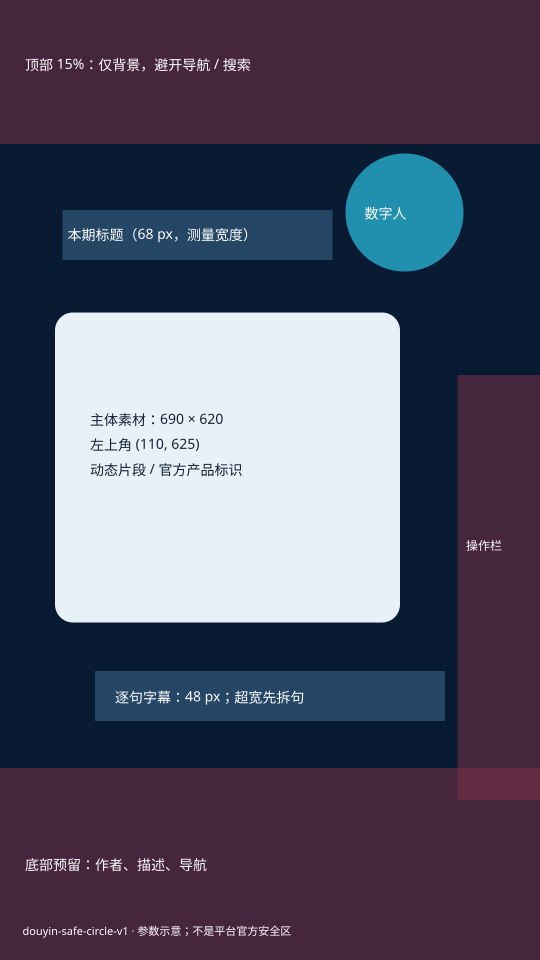

# 数字人口播圆框模板 V1

配置真值：[douyin-safe-circle-v1.json](../config/avatar-layouts/douyin-safe-circle-v1.json)。入口：[avatar_layout_template.py](../scripts/avatar_layout_template.py)。跨仓流程：[数字人口播视频](../../Haike-Videohub/agent-runbooks/数字人口播视频.md)。

## 复用范围

1080×1920、30fps；顶部留白、左侧标题、右侧圆形数字人、中部官方素材、下方短句字幕。顶部 15% 是本项目设计缓冲，不是平台官方标准。已通过的三秒样板是视觉基准，AI 概念图只是参考。

2026-09-28：正式入口用同一素材复跑，解码后的 90 帧与用户确认样板逐帧一致；三秒背景资产输出也通过。新的全片布局和真实手机播放尚未验证。证据保存在本期项目的 `renders/template-tests/`，不提交媒体到知识库。

## 坐标合同



| 层 | V1 参数 |
|---|---|
| 顶部保留区 | y=0–288，仅背景 |
| 数字人 | x=.64W，y=.16H，直径=.22W；工作台取偶数后为 (691,307,236,236) |
| 圆框外沿 | 五像素青色描边；外沿顶部 y=302 |
| 标题 | Pillow 绘制点 (125,420)，微软雅黑粗体 68px，实际文字宽度≤540px |
| 素材 | (110,625,690,620)，默认居中 cover；关键产品内容被裁掉时先重构素材，不能盲用裁切 |
| 样板字幕 | Pillow 绘制 y=1342，画布水平居中，48px、4px 描边，实际宽度≤700px、底部≤1498 |

圆框定位以左上角为锚点，x/width 相对画布宽度，y 相对高度。脸部 `face_crop.x/y` 是可移动裁切范围的比例，不能当作脸在画布上的中心；`zoom` 与源图裁切另行记录。原案例使用 x=.48、y=.38、zoom=1.15，仅适用于原素材。新人物须检查自拍视角、头顶/下巴、视线及动作边界。

## 本地样板与素材编译

从 [episode-spec.example.json](../config/avatar-layouts/episode-spec.example.json) 复制到**本期项目**，填入本期标题、片段 ID、官方素材路径/来源/权利状态、入出点、人物源和已确认混音。相对媒体路径以项目目录为根；样板数据文件位置不限。示例 URL/ID 是占位符，不可当作已采集素材。

在 Haike_video 根目录运行（`<项目>` 等须替换为本期真实路径）：

```text
python scripts/avatar_layout_template.py inspect --project <项目> --spec <本期JSON>
python scripts/avatar_layout_template.py render-test --project <项目> --spec <本期JSON> --output <项目>/renders/template-tests/opening-v001.mp4
python scripts/avatar_layout_template.py render-background --project <项目> --spec <本期JSON> --output <项目>/assets/video/clean-master/background-v001.mp4
python scripts/avatar_layout_template.py diagram --output docs/diagrams/avatar-safe-circle-v1.svg
```

- `render-test` 上限 10 秒，默认做三秒。仅写独立样板及同名 manifest，不入队、不改工作台、不重生成付费数字人。单句测试字幕只适用于该段；有多句时先缩短测试区间，正式全片必须用逐句时轴。
- `render-background` 仅生成背景、标题、素材卡和圆框外沿；无人物、字幕或音频。作为工作台素材使用，避免双重叠加。
- 缺字体报错；跨机器用 `--font` 显式指定并重新视觉核验。标题/字幕溢出报错，先缩短或拆句。源区间越界、素材时长不覆盖计划、混音未声明已确认都会拒绝。
- 输入已混音音轨不再次施加 -9 dB。manifest 记录配置、字体、输入、输出哈希、几何及技术参数；`platform_ui_verified=false` 不代表已经真机验收。
- 默认拒绝覆盖输出；需要新版本优先换文件名。媒体来自临时下载目录时，正式全片前移入项目素材库并更新来源记录。

## 接入正式全片

1. 按工作台当前项目读取已有素材、音频、人物 master、已运行任务；保留可复用的付费产物。此工具不是另一个全片生产器。
2. 各场景编译对应背景资产，经 `POST /api/project/{id}/workbench/assets` 登记；保留官方原始素材的 ID、来源及区间溯源。经 `PUT .../workbench/scenes/{scene}/visual-timeline` 更新本期时间轴并读回，不覆盖未知锁定内容。
3. 经 `POST .../workbench/presenter-layouts` 保存本配置的 geometry、circle、当前人物 face_crop/crop_bottom；用当前 API 的 `apply_scope` 应用，读回每个有数字人的场景。不要为了改位置再生成 avatar master。
4. 全片字幕走工作台 `POST .../workbench/subtitle-styles` 与逐句内容/时轴。设 48px 粗体、白色、深色描边、短句居中，宽度目标 700/1080。**工作台 ASS anchor 与 Pillow 绘制点不同，不能把 y=1342/1920 直接当作 bottom-center。** 先渲染一个带字幕场景，按实际文字边界对齐本图字幕区，再保存样式并应用全片；字体差异与最长句必须核查。V1 全片 ASS 样式对齐尚待下一期验证，不能声称逐像素相同。
5. full_preview 通过 `/api/production-queue/jobs` 或统一 queue CLI 提交；预览和最终成片使用同一时间轴、人物/字幕配置。走现有完整预览、人工确认、正式渲染闸门。用户已经确认的样板与混音不重复索要确认；实质变化再核验。
6. 看最长标题/字幕、首次产品露出、切换帧、人物动作边界及结尾。UI 蒙版只用于 QA，不烧进正式成片。实际平台裁切、搜索栏、右操作栏、作者/描述遮挡见跨仓 runbook。

更改几何或字体需新版本配置，重新生成示意图与三秒样板；不能只改图而保留旧参数。新主题替换每期数据，不能继承旧题材的事实、标题、素材或权利结论。
